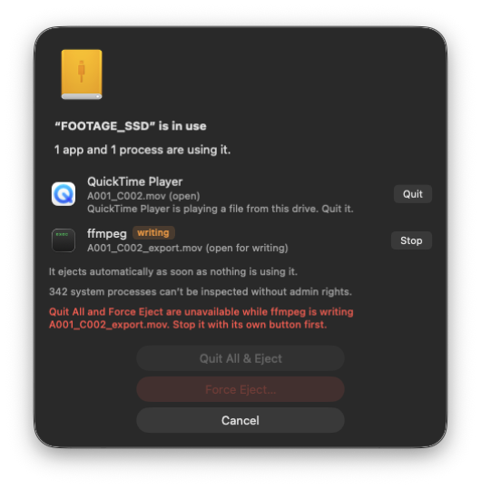
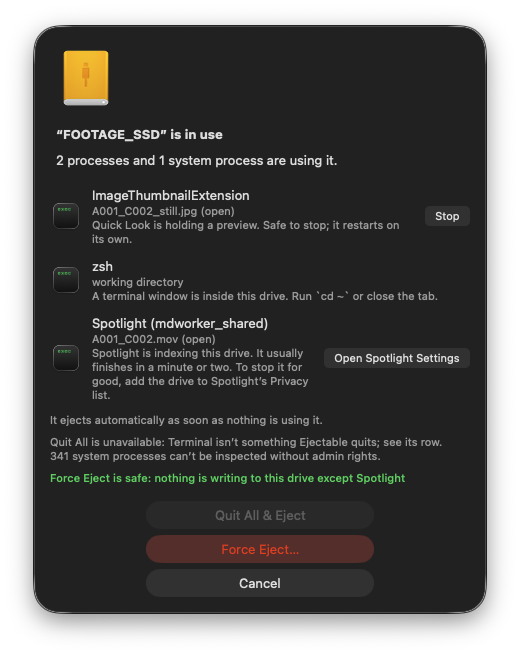
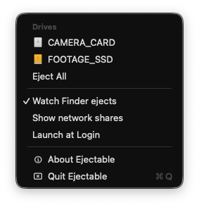

# Ejectable

A small macOS menu-bar app that shows which apps and processes are keeping an external drive from ejecting, lets you
quit them in place, and ejects the drive the moment it is free.

<p align="center"></p>

## Why macOS says "one or more programs may be using it"

Apple's "The disk wasn't ejected" dialog is drawn by `UnmountAssistantAgent`, which names a culprit only when the
process holding the disk, or one of its parents, is a regular app. Most real holders are not: Spotlight's
`mds_stores`, Time Machine's `backupd`, Quick Look previews, Finder's AirDrop / share-sheet extension, Photos and Adobe
helpers all fall through to the generic text. Some holders only have a file memory-mapped, and on APFS and exFAT
Apple's own check misses those entirely: libproc passes a 32-bit device number where the kernel compares a 64-bit
filesystem id, so the mapped-file lookup fails and the process looks innocent
([repro](docs/recon/reference/libproc-fsid-bug-repro.c)). Ejectable scans every process itself (open files, working
directories, memory-mapped files, about 130 ms) and names each holder with the file it holds.

## What it does

- **Menu-bar eject.** Every external drive and disk image is listed; click one to eject its whole disk, or Eject All.
  SMB/AFP shares get their own section with Disconnect.
- **In-use alert** when an eject is blocked: one row per holder with its icon, the file it holds, an orange
  **writing** tag for writers, and the row's own button (Quit, Stop, Open Spotlight Settings…). While a row waits for a
  quit, its Force Quit / Force Stop / Kill appears only when you hover over the row or Tab to it.
- **Auto-retry.** The alert re-checks every second and ejects as soon as nothing holds the drive; the menu bar then
  shows "Ejected NAME" (plus "Premiere Pro still running" when a video editor is open, since an editor between
  autosaves is invisible to any scanner).
- **Finder-companion mode** ("Watch Finder ejects", on by default): when Finder, Disk Utility or `diskutil` fails to
  eject, Ejectable shows its alert next to Apple's without taking focus, and finishes the job once the drive is free.
- **Remedies** for what can't simply be quit: Spotlight (add the drive to Spotlight's Privacy list), Time Machine
  (wait or stop the backup), Quick Look (stop it; it restarts by itself), AirDrop / share sheet (close it), a terminal
  inside the drive (`cd ~`), Photos and Music helpers, sync and backup agents.
- **Force Eject rating** next to the button: **safe** (nothing is writing), **risky** (media mapped in memory, which can
  crash that app, or a process that can't be inspected) or **unavailable** with the reason.

<p align="center"> </p>

<sub>Screenshots from disk images on a development Mac; some holders in the second one are stand-in processes.</sub>

## Safety

- **It never forces anything automatically.** The only action it takes on its own is a normal eject, the same request
  Finder makes: macOS refuses it while any file is open, and a successful eject has written everything to the disk.
- **Apps quit the normal way**, so they can ask to save changes (never SIGTERM, which would skip that). Command-line
  tools get SIGTERM, and SIGKILL only on a second, separate click. Force Quit, Force Stop and Kill act on one process
  per click and say what they cost; "Quit All & Eject" never forces.
- **Force Eject is a separate, confirmed step**, never the default button and never reachable with Return. It is
  disabled while anything is writing to the drive, while Time Machine is backing up to it (or its state can't be read),
  or when the scan couldn't check every process. Every volume is flushed before a forced unmount.
- **System daemons are never killed** (Spotlight, Time Machine, fseventsd, Photos' library, Resolve's database): rows
  explain them and offer the fix. The one exception is Quick Look, which only reads files and restarts by itself.
- **The app never approves or vetoes ejects for the system.** It watches other apps' ejects as an observer only: its
  DiskArbitration callback answers immediately with no objection, so it can't block or delay Finder or anyone else.
- **Only external disks and disk images** are ever ejected, never the boot disk or an internal disk; the target is
  re-checked right before each request, and a disk with several volumes says "Ejects all N volumes" first.
- **Every pid is re-verified** (executable path and start time) right before it is quit or signalled, so a recycled
  pid can't hit the wrong process.
- **Everything is logged** to `~/Library/Logs/Ejectable/actions.log`.

The full rules and their tests: [docs/PLAN.md §4b](docs/PLAN.md#4b-safety-rules-non-negotiable-every-builder-and-reviewer-checks-these).

## Install

Requirements: macOS 14 or later. The app is a universal binary (Apple silicon and Intel); it has been tested on Apple
silicon only. It is not sandboxed (a sandboxed app can't see other processes) and needs no admin rights.

**From source** (Xcode 26 / Swift 6.2 or later):

```sh
git clone https://github.com/benrusnac/ejectable.git && cd ejectable
./build.sh install      # builds, copies to ~/Applications/Ejectable.app and launches it
```

**From a release:** download `Ejectable-vX.Y.Z.zip` from Releases, unzip, move `Ejectable.app` to `~/Applications` or
`/Applications`. The app is ad-hoc signed, not notarized, so Gatekeeper blocks the downloaded copy; clear the
quarantine flag once (or use System Settings › Privacy & Security › Open Anyway):

```sh
xattr -dr com.apple.quarantine ~/Applications/Ejectable.app
```

**Launch at Login:** turn it on in Ejectable's menu. macOS may ask you to allow it; the menu then shows
"Approve in System Settings › Login Items…". It is available only for the installed .app.

## Usage

Click the drive icon in the menu bar and pick a drive. If something holds it, the alert lists what and offers:

- **Quit All & Eject** (default): quits the apps and stops the tools listed, then ejects. Never forces.
- A row's own button for one holder, or its remedy for a system process; **Try Again** when only system processes
  are left (a fresh scan and a normal eject).
- **Force Eject…** (red): a confirmation that lists every holder first.
- **Cancel**.

Menu toggles: **Watch Finder ejects**, **Show network shares**, **Launch at Login**. **About Ejectable** shows the
version and opens the log folder.

## Limits

- Processes owned by root or another user (`mds_stores`, `backupd`, `fseventsd`, antivirus) can't be inspected without
  admin rights. They appear by name when macOS reports them (the alert says how many processes it couldn't inspect),
  but Ejectable can't see their files or stop them.
- RAID sets and volumes spanning several disks are listed but not ejected (use Disk Utility).
- Apple's dialog still appears in Finder-companion mode; it can't be suppressed, only dismissed.
- In Finder-companion mode Ejectable finishes only what was asked: macOS reports a failed Finder eject as a failed
  unmount, so it unmounts the volume ("unmounted — safe to disconnect") rather than spinning the disk down.
- A menu eject is always the whole physical disk, like Finder's "Eject All".

## Debugging

- `~/Library/Logs/Ejectable/actions.log`: every scan, quit, signal, eject and force eject with time, pid and path
  (rotated at 1 MB; also in the unified log, subsystem `com.benrusnac.ejectable`, paths private).
- `build/ejectctl` (built by `./build.sh`) is the engine without the UI:

  ```sh
  ejectctl volumes                # external volumes and network shares, with disk and location
  ejectctl scan /Volumes/NAME     # holders, reasons, writers (read-only)
  ejectctl eject /Volumes/NAME    # soft eject; disk images only unless --real
  ejectctl watch                  # print other apps' eject attempts as they happen
  ```

- Debug builds (`swift build`) have extra entry points, enabled only with `EJECTABLE_DEBUG=1`; release builds don't
  contain them. See [Sources/Ejectable/DebugSupport.swift](Sources/Ejectable/DebugSupport.swift).

## Development

```sh
swift build                 # debug build
swift test                  # 130 tests, a few minutes
ARCHS=arm64 ./build.sh run  # release .app (arm64 only, faster), launched from build/
./build.sh help             # all build.sh modes
```

Tests run against small disk images, never real disks. `Tests/fixtures/make-busy-volume.sh` creates an APFS, HFS+ or
exFAT image mounted at `/Volumes/DUTEST_*` and starts holder processes on it (open file, writer, working directory,
memory-mapped read / write / copy-on-write); it refuses any other name and only ever detaches its own image.
`Tests/fixtures/make-test-app.sh` builds the small GUI apps the quit tests use. The rule for every test: act only on
fixtures and processes the test created itself; real disks may only be read. See [CONTRIBUTING.md](CONTRIBUTING.md),
and [docs/PLAN.md](docs/PLAN.md) and [docs/recon/RECON.md](docs/recon/RECON.md) for the design and the macOS
behaviour it is built on.

## License

[MIT](LICENSE) © 2026 Ben Rusnac
